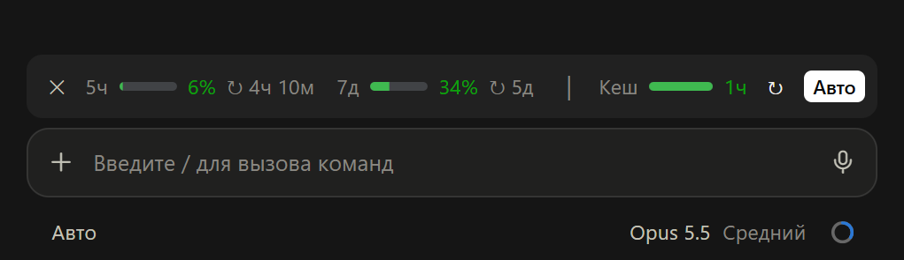

# limits-cache

 

Полоса над полем ввода: сколько лимитов аккаунта вы потратили и через сколько остынет кеш промпта.



## Что на полосе

| Элемент | Что показывает |
|---|---|
| `5ч 6% ↻ 4ч 10м` | Пятичасовое окно: процент расхода и время до сброса |
| `7д 34% ↻ 5д` | Недельное окно: процент расхода и время до сброса |
| `Кеш 1ч` | Сколько осталось жить кешу промпта |
| `↻` | Прогреть кеш сейчас |
| `Авто` | Прогревать кеш самому, пока вы не пишете |
| `✕` | Закрыть полосу |

Полоса окрашена по остатку: зелёная, пока осталось больше половины, жёлтая до пятой части, ниже красная. Остывший кеш показан полной красной полосой и словом «остыл».

## Прогрев кеша

Кнопка `↻` отправляет короткий запрос из скрытого форка сессии. Запрос попадает в тот же кеш, и отсчёт начинается заново. В чате форк не виден.

«Авто» включено с начала сессии и прогревает кеш за 3 минуты до конца (за минуту, если кеш живёт 5 минут). Если вы ничего не пишете час, «Авто» выключается до конца сессии: держать кеш дальше нет смысла.

## Зачем прогревать кеш

Claude Code хранит контекст сессии в кеше промпта. Пока кеш жив, каждый запрос читает контекст за 10% цены входа и продлевает кешу жизнь. Если вы ушли дольше, чем живёт кеш, следующее сообщение записывает весь контекст заново.

| Что происходит | Цена контекста |
|---|---|
| Прогрев: чтение из кеша | ×0,1 от цены входа |
| Остывший 5-минутный кеш: запись заново | ×1,25 |
| Остывший часовой кеш: запись заново | ×2 |

Пример: в сессии 200 тысяч токенов контекста. Прогрев стоит как 20 тысяч токенов входа, перезапись часового кеша как 400 тысяч, в 20 раз дороже. Ответ после паузы к тому же приходит быстрее. Множители взяты из тарифов API Anthropic.

## Команды

| Команда | Что делает |
|---|---|
| `/limits` | Вернуть закрытую полосу |
| `/usage` | То же в терминале. В десктопе `/usage` открывает окно приложения, поэтому там работает только `/limits` |

## Установка

```bash
claude plugin marketplace add petrovyuri/claude-code-mods
```

```bash
claude plugin install limits-cache@petrovyuri-mods --scope user
```

В открытой сессии выполните `/reload-plugins`.

## Откуда данные

- На подписке лимиты мод берёт из того же API, что и `/usage`: раз в 10 минут и после ответов, но не чаще раза в 2 минуты.
- С API-ключом, через шлюз или облачного провайдера полоса показывает то, что сообщают сами ответы.
- Время жизни кеша (5 минут или час) мод читает из транскрипта сессии.

Изменения по версиям: [CHANGELOG.md](CHANGELOG.md).
