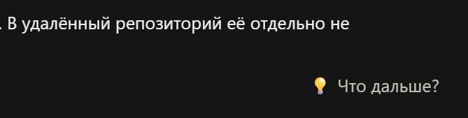
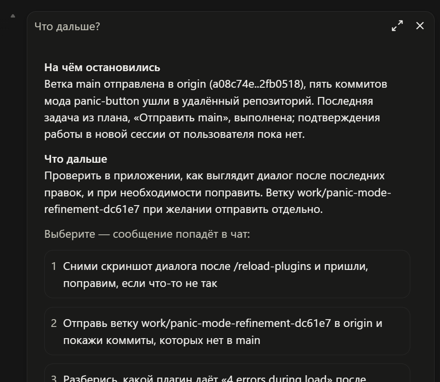

# next-step

 

Кнопка «Что дальше?» под последним ответом. Она напомнит, на чём вы остановились, и предложит, что написать дальше.





## Как работает

1. Под последним ответом Claude появляется кнопка «Что дальше?».
2. Вы нажимаете её, и дешёвая модель читает сессию.
3. В панели появляются два раздела: «На чём остановились» и «Что дальше».
4. Ниже идут готовые сообщения карточками. Вы выбираете одно, и оно попадает в чат.

Новое сообщение в чате или `/clear` закрывают устаревшую панель и отменяют запрос, если он ещё идёт.

## Команды

| Команда | Что делает |
|---|---|
| `/next-step` | Открыть панель без кнопки |

## Настройка

Модель для сводки выбирается в настройках мода:

| Значение | Когда брать |
|---|---|
| `haiku` (по умолчанию) | Быстрее и дешевле |
| `sonnet` | Точнее на длинных и запутанных сессиях |

## Установка

```bash
claude plugin marketplace add petrovyuri/claude-code-mods
```

```bash
claude plugin install next-step@petrovyuri-mods --scope user
```

В открытой сессии выполните `/reload-plugins`.

Изменения по версиям: [CHANGELOG.md](CHANGELOG.md).
